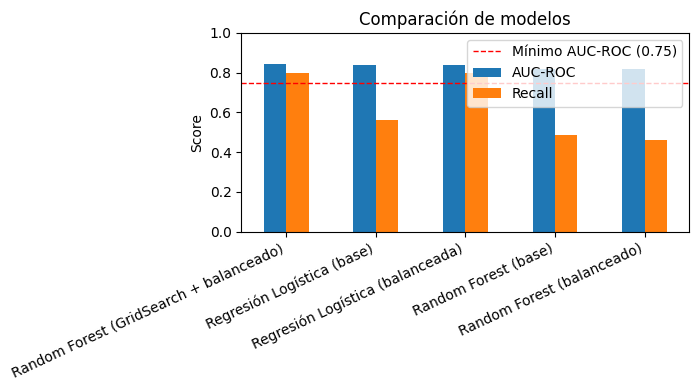

# Predicción de cancelación de clientes (churn): Interconnect

Modelo de clasificación que identifica a los clientes de un operador de telecomunicaciones con riesgo de darse de baja, para que el equipo de marketing les ofrezca promociones de retención a tiempo.

> Proyecto final del bootcamp de Ciencia de Datos de **TripleTen** (2026).

## Resultados

| Métrica (conjunto de prueba) | Valor |
|---|---|
| **AUC-ROC** | **0.839** |
| **Recall** | **0.797** |
| Bajas detectadas | 372 de 467 (8 de cada 10) |
| Ingreso mensual que se puede intentar retener | **~$27,350 USD** |

El modelo final es una **Regresión Logística con balanceo de clases**.



## Problema de negocio

Interconnect quiere anticiparse a la cancelación de sus clientes. El objetivo es predecir si un cliente se dará de baja (sí/no):

- **Métrica principal:** AUC-ROC (mínimo requerido: 0.75).
- **Métrica secundaria:** Recall. Un falso negativo es un cliente que se va sin que se le ofrezca nada, y ese error cuesta mucho más que una promoción de más.

## Datos

Cuatro tablas unidas por `customerID` (7,043 clientes):

| Archivo | Contenido |
|---|---|
| `contract.csv` | Fechas de alta y baja, tipo de contrato, método de pago, cargos |
| `personal.csv` | Datos demográficos |
| `internet.csv` | Servicios de internet contratados |
| `phone.csv` | Servicios de telefonía |

## Enfoque

1. **Unión de tablas:** usé `contract` como base (*left join*). Los nulos de los servicios no contratados se rellenaron con la categoría `"No service"` en lugar de imputarlos, para no inventar servicios.
2. **Variable objetivo:** `churn = 1` si `EndDate` tiene fecha. `EndDate` se eliminó de las variables para evitar **fuga de datos** (*data leakage*).
3. **Ingeniería de variables:** antigüedad del contrato en meses (`tenure_months`) y `TotalCharges` convertido a numérico (los 11 vacíos son clientes recién dados de alta, así que se rellenaron con 0).
4. **Preprocesamiento:** One-Hot Encoding para las categóricas y `StandardScaler` ajustado solo con *train* para la Regresión Logística.
5. **Modelado:** baselines de Regresión Logística y Random Forest, después balanceo de clases (`class_weight='balanced'`) y `GridSearchCV` para el Random Forest.

| Modelo | AUC-ROC | Recall |
|---|---|---|
| Random Forest (GridSearch + balanceado) | 0.842 | 0.797 |
| Regresión Logística (base) | 0.839 | 0.563 |
| **Regresión Logística (balanceada)** ✅ | **0.839** | **0.797** |
| Random Forest (base) | 0.821 | 0.484 |
| Random Forest (balanceado) | 0.820 | 0.463 |

## ¿Por qué Regresión Logística y no Random Forest?

El Random Forest optimizado obtuvo un AUC-ROC apenas mayor (0.842 frente a 0.839) con el mismo Recall. Como la diferencia es marginal, elegí el **modelo más simple**:

- Es más rápido de entrenar y de reentrenar con datos nuevos.
- No requiere búsqueda de hiperparámetros.
- Sus coeficientes son **explicables para el equipo de marketing**, porque muestran qué variables aumentan o reducen el riesgo de fuga.

## Impacto de negocio

En el conjunto de prueba (1,761 clientes, 467 bajas reales):

- ✅ **372 clientes en riesgo detectados**, unos **$27,350 USD/mes** en ingresos que se pueden intentar retener.
- ⚠️ **95 no detectados** (falsos negativos), unos $6,990 USD/mes.
- 🔔 **371 falsas alarmas.** Su costo es bajo: ofrecer una promoción a alguien que se iba a quedar cuesta mucho menos que perder a un cliente.

## Estructura del repositorio

```
churn-interconnect/
├── data/                       # 4 archivos CSV
├── images/                     # gráficas del análisis
├── notebooks/
│   └── churn_interconnect.ipynb
├── requirements.txt
└── README.md
```

## Cómo ejecutarlo

```bash
git clone https://github.com/LAHRZ23/churn-interconnect.git
cd churn-interconnect
pip install -r requirements.txt
jupyter notebook notebooks/churn_interconnect.ipynb
```

## Tecnologías

Python · pandas · NumPy · scikit-learn · Matplotlib · Jupyter

## Autor

**Luis Antonio Hernández Ruiz**, Data Scientist Jr
[LinkedIn](https://www.linkedin.com/in/luis-antonio-hern%C3%A1ndez-ruiz-1abb21185/) · [GitHub](https://github.com/LAHRZ23)
